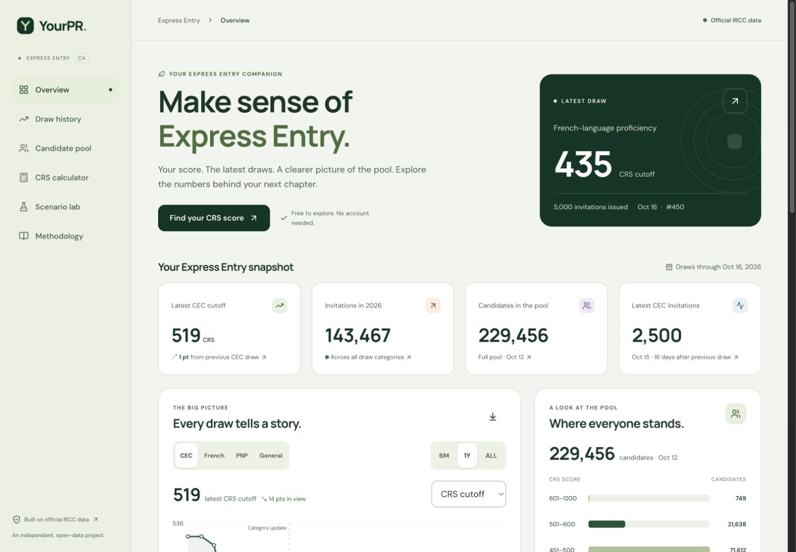

# YourPR · Express Entry

**Make sense of Express Entry.**

[Live website](https://yourpr.vercel.app) · [API health](https://yourpr-api-production.up.railway.app/health) · [GitHub](https://github.com/balkashynov/yourpr)

An independent Express Entry dashboard built around official IRCC evidence. Explore historical draws, candidate pool bands, and explicitly conditional CEC scenarios in a responsive, accessible interface.



## What’s inside

- **Overview** — latest draw, CEC metrics, cutoff/invitation charts, full-pool distribution, recent rounds.
- **Draw history** — program filters, time ranges, searchable archive, tie-breaking details, official links, CSV export.
- **Candidate pool** — historical snapshots, observed score bands, and interactive uniform/smooth reconstructions with sharp bounds on candidates above your score.
- **CRS calculator** — guided mobile form, verified points grid, local-only answers, and score handoff to pool/scenario views.
- **Scenario lab** — immediate browser-local CEC sensitivity calculations with adjustable draw size, timing, horizon, and pressure; exportable results.
- **Methodology** — actual walk-forward errors, interval coverage and widths, source fingerprints, policy timeline, glossary, and model limitations.

The pinned dataset contains **451 official draws** (January 31, 2015 – October 16, 2026), retrieved October 21, 2026. Observations, assumptions, and estimates are labeled separately. A source failure retains the last valid snapshot and surfaces its age.

> **Model status:** exploratory. The current-period regression loses to the last-cutoff baseline (MAE 2.36 vs 1.89 CRS; nine test draws). No invitation or permanent-residence probabilities are published. IRCC’s announced November 3, 2026 scoring change is explicitly flagged; post-change scenario values freeze earlier rules and are not forecasts under the new system.

## Project layout

```text
frontend/                  React + TypeScript + Vite + Recharts → Vercel
  src/data/snapshot.json    Versioned official-data fallback
  src/                     UI, schemas, browser-local scenario math, parity tests
  vercel.json              Vercel build and response headers
backend/                   FastAPI + NumPy + SciPy → Railway
  app/data.py              Source preservation, strict parser, SQLite normalization
  app/model.py             Rolling backtests and deterministic sensitivity model
  app/pipeline.py          Reproduction, refresh, manual official JSON import
  app/main.py              Stateless public API and optional refresh worker
  data/raw/                Immutable SHA-256-addressed official response
  data/snapshot.json       Normalized data and validation report
  tests/                   Data integrity, leakage, API, failure, parity tests
  Dockerfile               Railway-compatible container
docs/                      Source audit, model plan, deployment and verification notes
scripts/                   Cross-language parity fixture generator
compose.yaml               Local production-style two-service setup
Makefile                   Common commands
```

## Run locally

Requirements: **Node.js 22.12+ (22 or 24 LTS)**, **Python 3.12+**, and **uv**. No database service, credentials, or paid API are needed.

```sh
make setup
```

In two terminals:

```sh
make backend
```

```sh
cp frontend/.env.example frontend/.env.local
make frontend
```

Open **http://localhost:5173**. API documentation is at **http://localhost:8000/docs**.

The frontend also runs on its own: leave `VITE_API_URL` unset/empty to use the bundled snapshot. This is a static-data mode, not a live feed; the UI shows retrieval time and warns after 3 hours. With the API configured, it validates the response and falls back on timeout, network error, or schema mismatch. A frontend build never depends on Railway availability.

Alternatively:

```sh
docker compose up --build
```

Compose serves the frontend on port 5173 and the backend on 8000. Its refresh worker checks IRCC at startup and hourly. Avoid running the dev servers on those same ports at the same time.

## Reproduce the analysis

```sh
make reproduce
make verify
```

`make reproduce` verifies the raw response hash, parses and validates records, rebuilds SQLite and JSON, fits each policy period independently, runs walk-forward baselines, exports the frontend snapshot, and updates parity fixtures. Once dependencies are installed it needs **no network access**. The CLI prints actual baseline errors and quarantined records.

`make verify` runs backend tests, frontend numerical parity/schema tests, TypeScript checks, and the production build. CI also rejects differences between regenerated and committed snapshots.

Fetch a fresh official snapshot and refresh both bundled copies:

```sh
make refresh
```

Review the audit output and changed raw/source files before committing. The command fails without replacing the published snapshot when the official feed is unavailable or fails validation. For an official JSON file downloaded manually:

```sh
cd backend
uv run python -m app.pipeline import \
  --file /absolute/path/to/ee_rounds_123_en.json \
  --retrieved-at 2026-10-21T06:15:58+00:00 \
  --output data --export ../frontend/src/data/snapshot.json
```

Use the file’s actual retrieval time. The importer supports the official JSON schema; arbitrary CSV schemas are intentionally not guessed. After a manual import, run `backend/.venv/bin/python scripts/export-scenario-reference.py` from the repository root and `make verify`.

## Deploy separately

| Service         | Project root | Build                               | Configuration                                                                         |
| --------------- | ------------ | ----------------------------------- | ------------------------------------------------------------------------------------- |
| Vercel frontend | `frontend`   | `npm ci` → `npm run build` → `dist` | `VITE_API_URL=https://YOUR-API.up.railway.app`                                        |
| Railway backend | `backend`    | Included Dockerfile                 | `CORS_ORIGINS=https://YOUR-SITE.vercel.app`, `REFRESH_ENABLED=true`, `DATA_DIR=/data` |

Add a persistent Railway volume mounted at `/data` to retain raw archives and last-good data across deployments. Run **one replica and one Uvicorn worker** with the internal refresher. It refreshes once at startup and then hourly; errors are logged and exposed in `/api/data/status`.

See [the deployment guide](docs/deployment.md) for exact setup, freshness behavior, storage, and failure checks. YourPR uses its own Railway and Vercel projects. The [deployment guide](docs/deployment.md) records the production URLs and settings.

## API

| Endpoint                               | Purpose                                               |
| -------------------------------------- | ----------------------------------------------------- |
| `GET /health`                          | Process/data readiness and stale flag                 |
| `GET /api/data/status`                 | Provenance, retrieval age, audit, last refresh result |
| `GET /api/dashboard`                   | Complete normalized bundle, model and validation      |
| `GET /api/draws?category=CEC&limit=50` | Latest matching official draws                        |
| `GET /api/pool-snapshots`              | Validated historical full-pool snapshots              |
| `GET /api/backtests`                   | Period-specific rolling evaluation                    |
| `POST /api/scenarios`                  | Stateless conditional CEC sensitivity path            |

```json
{
  "crs_score": 510,
  "category": "CEC",
  "draw_size": 3000,
  "interval_days": 14,
  "horizon_draws": 6,
  "assumptions": "base"
}
```

The public website calculates scenarios locally; it does not send the visitor’s CRS score to the API or store it. API clients may opt into the stateless POST route. No analytics, accounts, cookies, or user-contributed outcome collection are included.

## Sources and scientific scope

- [How the math works](docs/how-the-math-works.md) — a plain-English guide to the data pipeline, exact equation, worked scenario, accuracy checks and limitations.
- [Pool distribution model](docs/pool-distribution.md) — reproducible uniform and smooth full-pool reconstructions, exact band constraints, and bounds on candidates above each score.
- [IRCC invitation rounds](https://www.canada.ca/en/immigration-refugees-citizenship/services/immigrate-canada/express-entry/rounds-invitations.html)
- [Official JSON](https://www.canada.ca/content/dam/ircc/documents/json/ee_rounds_123_en.json)
- [Data audit](docs/data-audit.md) — schemas, missingness, anomalies, coverage and publication-time limitations.
- [Model plan](docs/model-plan.md) — identifiability, equations, actual validation results, and release gate.
- [Verification](docs/verification.md) — what was checked and known limits.

This project is not affiliated with IRCC and does not assess immigration eligibility. Original project code is MIT licensed; official source material is separately attributed and remains subject to the Government of Canada’s applicable terms. Preserve source links and timestamps when redistributing data.

## CRS calculator and date-aware behavior

The browser-only guided calculator implements the verified March 25, 2025–November 2, 2026 CRS grid, including spouse factors, five approved test formats, skill-transferability caps, French bonuses and nomination points. It passes the selected score into the scenario lab. See [scoring sources and limits](docs/crs-calculator.md).

Scenario controls start at recent same-regime CEC medians and show the last six draws. Hypothetical dates stay in the future and are not an IRCC schedule. Scoring announcements expire 30 days after their effective date. The model pauses at a scoring break until enough new-regime observations exist. The calculator routes users to IRCC from the known November 3 rule change until a new grid is verified; it never silently applies expired rules.
