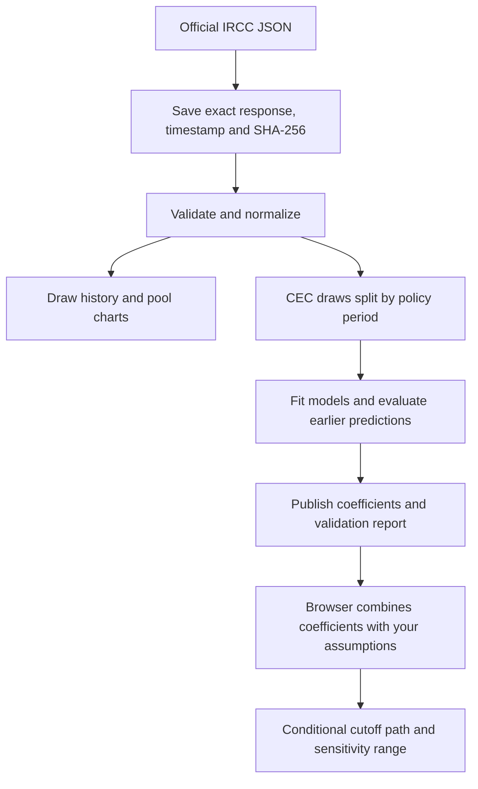

# How YourPR gets its data and makes scenarios

A plain-English guide to the implementation, with a worked example.

**Written October 21, 2026 · model `conditional-ridge-1.0.0`.** All numbers below come from the pinned October 21 data snapshot. Refreshing the data can change the fitted coefficients and results. This describes what the application actually does; possible improvements are marked separately.

## The short version

We download official draw history, clean it, and learn a small equation relating **changes in CEC cutoffs** to invitation counts, time between draws, and the previous cutoff. You choose hypothetical future draw sizes and intervals; we repeatedly apply that equation to draw a possible path.

That answers: **“What might happen under these assumptions?”** Predicting when IRCC will hold a draw, which type it will choose, and how many invitations it will issue would require additional models. Those decisions are inputs to our scenario, not predictions from it.

The tracker is backed by official observations. The scenario model is exploratory: in the latest test period, repeating the previous cutoff was more accurate than our regression. We show that result instead of presenting the scenario as a reliable invitation forecast.

## 1. Where the data comes from

The source is [IRCC’s public rounds JSON](https://www.canada.ca/content/dam/ircc/documents/json/ee_rounds_123_en.json), associated with its [rounds of invitations page](https://www.canada.ca/en/immigration-refugees-citizenship/services/immigrate-canada/express-entry/rounds-invitations.html). No paid feed or user-submitted profiles are required. This is an observed public endpoint, not a guaranteed stable API contract.

| Source field                         | What we keep                        | Why it matters                                   |
| ------------------------------------ | ----------------------------------- | ------------------------------------------------ |
| `drawDate`, `drawNumber`             | Date and round ID                   | Orders observations and identifies their source  |
| `drawName`                           | Program/category and original label | Keeps CEC, PNP, French and other rounds distinct |
| `drawSize`                           | Invitations issued                  | A model input                                    |
| `drawCRS`                            | Lowest invited CRS score            | The outcome we try to estimate                   |
| `drawCutOff`                         | Tie-break timestamp, if supplied    | Helps explain the observed cutoff                |
| `drawDistributionAsOn`, `dd1`–`dd18` | Dated pool counts by score band     | Powers the pool charts                           |

The pinned response was fetched at **2026-10-21 06:15:58 UTC**. It contains **451 draws**, including **71 CEC draws**, and yields **126 validated unique pool snapshots**. Having 451 total draws does not mean having 451 comparable CEC training examples.



The SHA-256 is a fingerprint of the downloaded bytes. It lets us identify exactly which source response produced a result. We retain the raw response, parser version, retrieval time and source links, then publish a validated JSON bundle and SQLite database.

Cleaning matters. The source includes both broad pool bands and their subdivisions; adding both would count candidates twice. We use disjoint bands. All-zero placeholder pool records become missing data, not an empty pool. Repeated identical observations are deduplicated. An inconsistent pool observation associated with draw #247 is excluded, while its draw record remains available. Details are in the [data audit](data-audit.md).

When enabled, the backend refreshes once at startup and then hourly by default. A failed download or validation retains the previous valid published snapshot. The frontend can also run from its bundled snapshot and displays its age. Policy boundaries are maintained separately by review; refreshing the JSON does not automatically interpret new policy announcements.

## 2. Why we cannot just count people ahead of you

Think of a draw as selecting from a ranked queue of people **eligible for that particular round**. The cutoff is the score at the last selected position; ties can require the profile-submission timestamp. IRCC describes selection and tie-breaking on its [rounds page](https://www.canada.ca/en/immigration-refugees-citizenship/services/immigrate-canada/express-entry/rounds-invitations.html).

If a draw selects `k` candidates and the cutoff is `c`, that gives this ordering constraint, assuming all eligible candidates above the cutoff are selected:

```text
eligible candidates above c < k ≤ eligible candidates at or above c
```

It does not tell us the complete eligible queue. Our public pool observations describe the whole pool in bands, without a CEC-only breakdown or individual scores.

For example, the October 12 snapshot has **21,638 people in 501–600** and **749 in 601–1200**: 22,387 in full-pool bands above 500. We do not know how many of those people qualify for a CEC round. Nor can the 491–500 band tell us how many have exactly 499 or 500.

The pool also changes between observation and draw dates. Eligibility categories overlap, so subtracting every French or PNP invitation from a supposed CEC queue would be unjustified. Consequently, **the current regression does not use pool counts or simulate individual candidates**. The pool charts provide context, not a personal rank or a hidden CEC population estimate.

## 3. The equation we actually fit

We model the change from one CEC cutoff to the next:

```text
estimated next cutoff = previous cutoff + estimated change

estimated change = b0
                 + b1 × ln(next invitations / previous invitations)
                 + b2 × (days between draws − 14) / 14
                 + b3 × (previous cutoff − 520) / 20
```

`ln` is the natural logarithm. The four `b` values are coefficients learned from previous CEC draws in the same policy period.

| Term               | Intuition                                                           |
| ------------------ | ------------------------------------------------------------------- |
| `b0`               | A fitted starting adjustment when the other terms are zero          |
| Invitation ratio   | How much larger or smaller this draw is than the preceding CEC draw |
| Days between draws | Whether the gap is longer or shorter than two weeks                 |
| Previous cutoff    | Whether the starting score is above or below a chosen reference     |

The numbers **14, 520 and 20 are modeling choices for centering and scaling**. They are not immigration eligibility thresholds. In particular, 520 is not a predicted long-run destination: the intercept also affects the path.

We constrain `b1 ≤ 0` and `b2 ≥ 0`. Holding everything else fixed, a larger draw cannot raise the estimated cutoff, and a longer gap cannot lower it. Those directions are assumptions imposed on the model. Historical correlations do not establish that changing draw size or timing causes the fitted effect.

### How the coefficients are learned

For each pair of consecutive same-period CEC draws, we calculate the four inputs above and the actual cutoff change. We choose coefficients that minimize squared prediction errors, with a penalty for large coefficients:

```text
minimize:
  sum over training pairs of (actual change − estimated change)²
  + 0.09 × b0²
  + 4 × (b1² + b2² + b3²)

subject to b1 ≤ 0 and b2 ≥ 0
```

This is constrained **ridge regression**. The penalty discourages extreme fitted responses to a small dataset; it does not guarantee accuracy. The penalty settings are fixed in the code, rather than selected to make the test results look good. SciPy solves the bounded least-squares problem.

We fit separate periods instead of mixing all historic rules together. The current fitted period contains **15 CEC draws**, producing **14 consecutive-draw training pairs**. Earlier history remains useful for charts, but only the explicitly modeled periods enter these fits. See the [model plan](model-plan.md) for the boundaries and rationale.

## 4. A real worked example

In the pinned dataset, the latest CEC draw was **October 15, 2026: cutoff 519, with 2,500 invitations**. Suppose you select **3,000 invitations**, **14 days between draws**, and **base pressure**.

The fitted coefficients are:

```text
b0 =  0.52466855
b1 = −1.41873253
b2 =  0.30265196
b3 = −0.72764150
```

Substituting the inputs:

| Component           | Calculation                      | Contribution to cutoff change |
| ------------------- | -------------------------------- | ----------------------------: |
| Starting adjustment | `0.52466855`                     |                     +0.524669 |
| Invitations         | `−1.41873253 × ln(3000 / 2500)`  |                     −0.258666 |
| Gap                 | `0.30265196 × (14 − 14) / 14`    |                             0 |
| Previous cutoff     | `−0.72764150 × (519 − 520) / 20` |                     +0.036382 |
| **Total**           | Sum of these contributions       |                 **+0.302385** |

So the estimate is **519 + 0.302385 = 519.3**, rounded for display, on the hypothetical date **October 29**. This calculation shows why a bigger draw does not necessarily produce a lower total estimate: its downward contribution can be outweighed by the other terms.

The decimal describes the model output. Actual observed CRS cutoffs are integer scores, and the decimal does not imply that the model is accurate to a tenth of a point.

## 5. How one estimate becomes a future path

For the second hypothetical draw, we reuse the first estimate as the previous cutoff and apply the equation again. We keep the selected draw size and interval constant. Internal calculations retain precision; displayed values are rounded to one decimal and bounded to 0–1200.

With the example inputs above:

| Step | Assumed date      | Estimated cutoff | Illustrative range |
| ---- | ----------------- | ---------------: | ------------------ |
| 1    | October 29, 2026  |            519.3 | 515.1–523.6        |
| 2    | November 12, 2026 |            519.9 | 513.8–525.9        |
| 3    | November 26, 2026 |            520.4 | 513.0–527.7        |
| 6    | January 7, 2027   |            521.9 | 511.5–532.3        |

**Steps 2 onward cross an announced policy boundary.** As checked October 21, IRCC’s [changes page](https://www.canada.ca/en/immigration-refugees-citizenship/services/immigrate-canada/express-entry/changes.html) announces scoring changes effective November 3 and a temporary pause in rounds while profiles are recalculated. These later rows illustrate frozen earlier rules; they do not estimate the new scoring system or predict that rounds will occur on those dates.

All scenario dates start from the **latest observed CEC draw**, not from today. They are arithmetic consequences of your interval setting.

### An important limitation of the invitation term

The model uses a **ratio**, not absolute draw size or an evolving pool. In this example, the first ratio is `3000 / 2500`. The next is `3000 / 3000 = 1`, and `ln(1) = 0`.

Thus the direct invitation-size adjustment disappears after the first step when the assumed size stays constant. Its earlier effect still influences the starting cutoff for later steps, but the model does **not** calculate continued pool depletion from repeatedly inviting 3,000 people. This limits how much we should infer from long paths or comparisons of sustained invitation volumes.

### Where the shaded range comes from

We calculate absolute errors from earlier one-step test predictions. The current period’s empirical 80th-percentile error, using the higher observed quantile, is **4.24950675 CRS**. Call that `r`.

```text
half-width at step h = r × √h
range = estimated cutoff ± half-width
```

At step 1, the half-width is about 4.25; at step 6, about 10.41. Bounds are clipped to 0–1200.

The square-root widening is a chosen stress assumption. We have not demonstrated that recursive forecast errors grow this way. **The shaded region is not a calibrated 80% probability interval**, even though its starting scale comes from an 80th percentile. It is also not a probability of receiving an invitation.

The pressure control adds `+0.5r`, `0`, or `−0.5r` to the calculated change at **every** step. Higher and lower pressure therefore add or subtract about **2.12 points per step**, before subsequent recursive effects. These are illustrative adjustments, not measured arrival rates or defined statistical percentiles.

Your entered CRS score only draws a reference line. It does not change the coefficients or the predicted path. Crossing that line is not an eligibility assessment or an invitation guarantee.

## 6. How we check whether the math helps

We compare the regression with two simple alternatives: use the last CEC cutoff, or take the median of the last three CEC cutoffs.

Evaluation proceeds in time order:

1. Start with six CEC draws from one policy period.
2. Fit using only strictly earlier draw dates, then estimate the next cutoff.
3. Record the error after comparing with the observed cutoff.
4. Add that observation to the available history, refit, and repeat.

This is a **walk-forward backtest**. It avoids fitting a prediction directly on its own target. However, it supplies the target draw’s actual invitation count and elapsed days. We are evaluating conditional cutoff estimates with the schedule given, not testing whether we could predict that schedule in advance.

We report mean absolute error, or MAE:

```text
MAE = sum of |actual cutoff − estimated cutoff| / number of test draws
```

An MAE of 2 means an average miss of two CRS points over that test sample. It is not a maximum error or a guarantee for the next draw.

| Method                       | 2025 scoring period MAE | 2026 category period MAE |
| ---------------------------- | ----------------------: | -----------------------: |
| Last observed cutoff         |                    2.89 |                 **1.89** |
| Median of last three cutoffs |                    5.67 |                     2.22 |
| Conditional ridge            |                **1.80** |                     2.36 |
| Test draws per method        |                       9 |                        9 |

The regression helps in the earlier period and loses to both simpler methods in the latest one. Its complexity has not earned a claim of better current predictive accuracy.

For historical interval tests, each radius uses only errors observed **before that test draw**, with at least five prior errors. This leaves only four interval tests per period. The latest nominal 80% regression intervals contain 4/4 outcomes, but four examples cannot establish reliable coverage. The future scenario’s radius instead uses all nine currently available test errors.

There is another limitation: the source is a historical file retrieved today, without archived publication-time versions for every record. Strict date ordering cannot rule out later revisions. We describe these results as retrospective; unknown publication timing is also a reason to exclude historical pool counts from predictors.

The coded minimum release gate requires at least **20 same-period test predictions** and regression MAE no worse than both baselines. It currently fails both conditions. Passing that gate would still require further calibration and prospective checks before publishing probability claims.

## 7. What would make future predictions stronger?

These are proposed next steps, not capabilities already implemented:

1. **Collect prospective evidence.** Archive each official response and save each forecast before the outcome arrives, including its assumptions and policy information available at the time. This lets us measure real performance without relying only on reconstructed history.
2. **Keep the simple models as competitors.** Test richer models against the last-cutoff baseline. More features are useful only if they improve performance on unseen draws.
3. **Separate schedule uncertainty from cutoff uncertainty.** If we later model draw timing and invitation counts, test those models separately and propagate their uncertainty. For now, present multiple explicit schedules.
4. **Relearn after policy changes.** Gather enough comparable post-change observations; do not assume old coefficients describe the new score distribution.
5. **Evaluate longer horizons directly.** Test two-, three- and six-draw paths against what actually happened, including intervals and large misses. One-step errors cannot establish multi-step accuracy.

A more ambitious model could track candidates in score buckets:

```text
next bucket count = current bucket count
                  + new entrants
                  + people moving into the bucket
                  − people moving out
                  − other exits
                  − invited eligible candidates
```

The accounting equation is straightforward. Estimating its components is hard: aggregate snapshots do not separately identify arrivals, score changes, overlapping eligibility and exits. Many different hidden populations can explain the same totals. Such a simulator would need stronger data or explicit assumption ranges, plus validation; adding it alone would not make the forecast trustworthy.

## 8. Reproduce it and find the code

From the repository root, after the setup in the [README](../README.md):

```sh
# Rebuild from the pinned raw response without downloading new data.
make reproduce

# Fetch new official data, rebuild the analysis and update bundled snapshots.
make refresh

# Run the existing data, model, API and frontend checks.
make verify
```

| File                                                        | Responsibility                                                |
| ----------------------------------------------------------- | ------------------------------------------------------------- |
| [backend/app/data.py](../backend/app/data.py)               | Parse, validate, archive and normalize source data            |
| [backend/app/pipeline.py](../backend/app/pipeline.py)       | Fetch or reproduce data and publish analysis                  |
| [backend/app/model.py](../backend/app/model.py)             | Fit coefficients, backtest, calculate scenarios               |
| [backend/app/main.py](../backend/app/main.py)               | Serve data and optionally run periodic refreshes              |
| [frontend/src/lib.ts](../frontend/src/lib.ts)               | Calculate matching scenarios in the browser                   |
| [backend/data/snapshot.json](../backend/data/snapshot.json) | Pinned observations, coefficients and individual test results |

The browser and backend implement the same deterministic formula, with numerical parity tests. There is no random simulation or language-model-generated forecast. Same data and same inputs produce the same displayed scenario.
